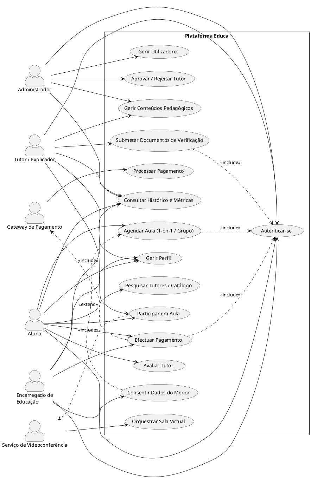

# Arquitectura Técnica — Plataforma de Explicações Online (Educa)

**Escalabilidade, Segurança, Conformidade ISO, Modelagem de Dados e Casos de Uso**

| | |
|---|---|
| **Empresa** | SOMATEC — Software Marketing Tecnologia (NIF: 5001795830) |
| **Email** | somatecangola@gmail.com |
| **Cliente** | Helder Teixeira Congo |
| **Local e data** | Angola - Luanda, 17 de Setembro de 2026 |
| **Referência** | ATB-EDUCA-2026-R1 \| Versão: 1.0 |
| **Documento base** | ATB-EDUCA-2026 v1.0 e Escopo Técnico e Funcional Consolidado (Ref. 8) |

---

## 1. Enquadramento e Objectivo deste Refinamento

O presente documento consolida o refinamento técnico da arquitectura da Plataforma Educa, tomando como base o Escopo Técnico e Funcional Consolidado (Ref. 8, Setembro 2026) e o documento Arquitectura Técnica Base (ATB-EDUCA-2026 v1.0). Mantém-se integralmente a decisão estratégica de Monólito Modular (Node.js/TypeScript, Prisma, PostgreSQL, SvelteKit e Flutter), aprofundando cinco frentes que os documentos anteriores não cobriam em detalhe suficiente:

1. Escalabilidade do monólito modular sob carga crescente.
2. Segurança de dados sensíveis, pagamentos e conteúdo protegido.
3. Conformidade com normas ISO e outras boas práticas recentes de desenvolvimento seguro de software.
4. Modelagem da base de dados (modelo entidade-relacionamento / diagrama de classes UML).
5. Casos de uso e diagramas UML, incluindo o código-fonte UML correspondente.

Nenhuma alteração de escopo funcional é proposta. As recomendações são exclusivamente técnicas, de infra-estrutura, segurança e documentação de engenharia, em conformidade com a Secção X (Limites e Gestão de Alterações) do Escopo Técnico e Funcional Consolidado.

---

## 2. Escalabilidade: Monólito Modular "Pronto para Separar"

### 2.1 Isolamento de Módulos por Contrato Interno

O maior risco de um monólito modular não é técnico, é disciplinar: com o tempo, módulos passam a chamar directamente os modelos Prisma uns dos outros, criando acoplamento invisível que torna qualquer extracção futura (ex.: `payments` ou `contents_datalite` como serviço separado) impraticável.

- Cada módulo expõe apenas uma camada de serviço pública (`*.service.ts`); acesso directo ao Prisma de outro módulo é proibido por convenção e reforçado com regras de fronteira de lint (ex.: `eslint-plugin-boundaries` ou `dependency-cruiser`), falhando o build em CI caso um módulo importe o repositório de dados de outro.
- Comunicação entre módulos migra de chamadas directas para um barramento de eventos interno (in-process, ex.: `EventEmitter2` ou BullMQ com Redis para eventos assíncronos): quando um pagamento é confirmado, `payments` emite `payment.confirmed`, e `bookings` reage a isso — sem saber da existência da tabela `PaymentTransaction`.
- Este padrão tem custo quase nulo agora e é exactamente o que permite, no futuro, extrair `contents_datalite` (processamento de vídeo, pesado em CPU) para um serviço dedicado sem tocar no resto do sistema.

### 2.2 Escalabilidade Horizontal da API

O monólito deve ser *stateless* para permitir múltiplas réplicas atrás de um balanceador de carga:

- Nenhuma sessão em memória local do processo; tokens JWT (ver secção 3.2) tornam cada instância independente.
- WebSockets (salas de aula, whiteboard, notificações): adaptador Redis (ex.: `@socket.io/redis-adapter`) para que eventos emitidos numa instância cheguem a clientes ligados a outra instância.
- Health-checks por módulo (`/health/payments`, `/health/bookings`) para detecção de degradação parcial.

### 2.3 Camada de Cache e Filas (Redis)

| Uso | Justificação |
|---|---|
| Cache de leitura | Perfis de tutores, catálogo e médias de avaliação — lidos muito mais do que escritos. |
| Filas de trabalho (BullMQ) | Processamento de vídeo/whiteboard, DPM, notificações e verificação de webhooks saem do ciclo request/response. |
| Rate limiting distribuído | Contadores partilhados entre réplicas para login, submissão de documentos e chamadas de pagamento. |

### 2.4 Base de Dados: Preparar o PostgreSQL para Volume

- Connection pooling externo (PgBouncer), essencial assim que existir mais do que uma réplica do backend.
- Índices dirigidos: `ClassSession(tutorId, scheduledAt)`, `ClassEnrollment(studentId)`, `PaymentTransaction(userId, status)`, `Review(tutorId)`.
- Réplicas de leitura para relatórios administrativos, isolando consultas analíticas do tráfego transaccional.
- Particionamento por data da tabela `AuditLog` (mensal), mantendo os índices eficientes.
- Migrações Prisma sempre aditivas e reversíveis em produção, permitindo rolling deploy sem indisponibilidade.

### 2.5 Entrega de Conteúdo e Modo Data-Lite

- Vídeo e materiais servidos via CDN com URLs assinadas de curta duração.
- Pipeline de transcodificação (360p/480p) como job assíncrono, em fila dedicada e separada da fila de notificações.

---

## 3. Segurança: Reforço do Monólito Modular

### 3.1 Modelo de Ameaças Específico da Educa

1. Existem menores de idade como utilizadores finais (perfil `STUDENT` sob `GUARDIAN`).
2. Tutores submetem documentos de identificação e registo criminal — dados altamente sensíveis.
3. A plataforma processa pagamentos e aplica DPM para proteger conteúdo pago contra pirataria.

### 3.2 Autenticação e Autorização

- Access tokens JWT de curta duração (10–15 min) + refresh token rotativo em cookie `httpOnly`, `Secure`, `SameSite=Strict` — nunca em `localStorage`.
- Detecção de reutilização de refresh token, com revogação imediata de toda a família de tokens da sessão.
- RBAC (4 perfis) evolui para RBAC + verificação de propriedade do recurso: a API valida que o aluno autenticado é titular da matrícula ou dependente do encarregado que faz o pedido.
- Acções administrativas sensíveis (aprovação de tutor, reembolsos, alteração de papéis) exigem MFA e segregação de funções.

### 3.3 Protecção de Dados Sensíveis e de Menores

- Campos de identificação (NIF, documentos) encriptados em repouso ao nível da aplicação, com chaves geridas por um serviço de segredos dedicado (AWS Secrets Manager / HashiCorp Vault).
- Documentos de tutores guardados em bucket privado (S3-compliant), acesso apenas via URL assinada de curta duração.
- Consentimento explícito do Encarregado de Educação registado e auditável antes de qualquer processamento de dados do menor (ver entidade `GuardianConsent`, secção 5).
- Minimização de dados no cliente mobile, com rotação de chaves de encriptação local por sessão.

### 3.4 Protecção da API e da Rede

- WAF e mitigação de DDoS na fronteira (ex.: Cloudflare).
- Rate limiting distribuído por IP e por utilizador em login, recuperação de conta, submissão de documentos e criação de referência de pagamento.
- Validação estrita de input em todas as fronteiras dos módulos (ex.: `zod`).
- TLS obrigatório ponta-a-ponta; HSTS activo.

### 3.5 Pagamentos e Webhooks

- Verificação de assinatura criptográfica de todos os webhooks (Proxypay/PayPay/Kwanza Online) antes de qualquer alteração de estado.
- Idempotência obrigatória (chave de idempotência por referência), evitando duplicação de libertação de pacotes de horas em caso de reentrega do webhook.
- Nenhum dado de cartão/conta é armazenado directamente pela Educa.

### 3.6 Protecção de Conteúdo (DPM) e Auditoria

- DPM reforçado com tokens de streaming assinados e vinculados à sessão (curta validade, uso único).
- Logs de auditoria imutáveis (append-only) com encadeamento de hash entre registos consecutivos (`hashPrev` / `hashSelf` — ver entidade `AuditLog`, secção 5).
- Alertas automáticos sobre padrões anómalos de acesso e download.

---

## 4. Conformidade com Normas ISO e Outras Boas Práticas de Software Seguro

O refinamento de segurança das secções 2 e 3 é alinhado, nesta versão, com um conjunto de normas internacionais aplicáveis ao ciclo de vida de desenvolvimento e operação de software. A tabela abaixo mapeia cada norma à sua área de aplicação prática na Educa.

| Norma / Referência | Âmbito | Aplicação prática na Educa |
|---|---|---|
| ISO/IEC 27001 | Sistema de Gestão de Segurança da Informação (SGSI) | Política de controlo de acesso, gestão de segredos e chaves, gestão de fornecedores (gateways de pagamento, videoconferência), resposta a incidentes. |
| ISO/IEC 27034 | Segurança de Aplicações (Application Security) | Requisitos de segurança definidos por módulo (`auth`, `payments`, `contents_datalite`), biblioteca de controlos de segurança reutilizáveis (ASC), revisão de segurança em cada release. |
| ISO/IEC 25010 (SQuaRE) | Qualidade de produto de software | Métricas-alvo por característica: Segurança (confidencialidade, integridade, não-repúdio via `AuditLog`), Fiabilidade, Eficiência de desempenho, Manutenibilidade (fronteiras de módulo da secção 2.1). |
| ISO/IEC/IEEE 12207 e 15288 | Processos de ciclo de vida de software e sistemas | Estruturação das fases de requisitos, arquitectura, verificação e validação já previstas no Escopo Consolidado (Secção IV.1 e IV.9). |
| ISO/IEC 29100 | Framework de privacidade | Base para o modelo de consentimento do Encarregado de Educação e minimização de dados de menores (secção 3.3). |
| ISO/IEC 27017 / 27018 | Segurança e protecção de PII em ambientes cloud | Aplicável à hospedagem, ao object storage de documentos de tutores e ao processamento de dados pessoais por fornecedores de nuvem. |
| OWASP ASVS / SAMM *(recomendação complementar, não-ISO)* | Verificação de segurança de aplicações web | Checklist de verificação por nível de risco para `auth`, `payments` e `tutors`, usada em conjunto com a ISO/IEC 27034. |
| NIST SSDF *(recomendação complementar, não-ISO)* | Ciclo de desenvolvimento seguro | Boas práticas de secure coding, revisão de dependências e gestão de vulnerabilidades no pipeline de CI/CD. |

### 4.1 Práticas de Ciclo de Desenvolvimento Seguro Adoptadas

- SAST (análise estática de código) e verificação de dependências vulneráveis integradas no pipeline de CI, bloqueando merge em caso de vulnerabilidade crítica (alinhado à ISO/IEC 27034 e ao NIST SSDF).
- Segredos nunca em repositório — geridos por cofre dedicado, injectados em tempo de execução (ISO/IEC 27001, domínio A.8).
- Ambientes de staging com dados sintéticos/anonimizados, nunca cópia directa de dados reais de produção (ISO/IEC 29100 — minimização e protecção de dados de menores mesmo em ambientes não produtivos).
- Revisão de segurança por módulo antes de cada release que altere `auth`, `payments` ou `tutors` (módulos de maior risco, conforme classificação ISO/IEC 27034).
- Testes de segurança e operação simulada, já previstos na Secção IV.9 do Escopo Consolidado, passam a incluir explicitamente testes de autorização (verificação de propriedade do recurso) e testes de idempotência de webhooks.

---

## 5. Modelagem da Base de Dados

### 5.1 Visão Geral do Modelo de Dados

O modelo relacional mantém as entidades definidas no documento ATB-EDUCA-2026 v1.0 e acrescenta três entidades necessárias para suportar os refinamentos de segurança e escalabilidade descritos nas secções 2 e 3: `HourPackage` (rastreio explícito de pacotes de horas libertados após confirmação de pagamento, conforme Secção IV.7 do Escopo Consolidado), `GuardianConsent` (consentimento auditável do Encarregado de Educação, conforme Secção IV.8) e `AuditLog` (registo de auditoria imutável, conforme Secção VIII).

### 5.2 Diagrama de Classes / Modelo Entidade-Relacionamento (UML)

O diagrama de classes do modelo de dados consta do PDF original. O código-fonte correspondente está no **Anexo A.2** (PlantUML). Resumo das classes e atributos:

| Classe | Atributos |
|---|---|
| `User` | id: UUID, name: String, email: String, nifTaxId: String?, role: Role, guardianId: UUID?, createdAt: DateTime |
| `TutorProfile` | id: UUID, userId: UUID, status: TutorStatus, diplomaUrl: String, criminalRecordUrl: String, passportPhotoUrl: String, videoIntroUrl: String, ratingAverage: Float, totalReviews: Int, totalClasses: Int, totalStudents: Int |
| `ClassSession` | id: UUID, tutorId: UUID, title: String, subject: String, type: ClassType, maxCapacity: Int = 7, scheduledAt: DateTime, durationMin: Int |
| `ClassEnrollment` | id: UUID, classId: UUID, studentId: UUID, attendanceStatus: String |
| `Review` | id: UUID, studentId: UUID, tutorId: UUID, rating: Int (1-5), comment: String?, punctuality: Int, subjectMastery: Int, didacticClarity: Int, progress: Int, createdAt: DateTime |
| `PaymentTransaction` | id: UUID, userId: UUID, gateway: String, reference: String, amount: Decimal, status: PaymentStatus, idempotencyKey: String, createdAt: DateTime, updatedAt: DateTime |
| `HourPackage` | id: UUID, userId: UUID, paymentId: UUID, totalHours: Decimal, remainingHours: Decimal, releasedAt: DateTime, expiresAt: DateTime? |
| `GuardianConsent` | id: UUID, guardianId: UUID, studentId: UUID, consentType: String, grantedAt: DateTime, revokedAt: DateTime? |
| `AuditLog` | id: UUID, actorId: UUID?, entityType: String, entityId: UUID, action: String, hashPrev: String, hashSelf: String, createdAt: DateTime |

Multiplicidades indicadas no diagrama:

- `User` 1 — 0..1 `TutorProfile`
- `User` 1 — 0..* `User` (auto-relação, encarregado → dependentes)
- `User` 1 — 0..* `PaymentTransaction`
- `User` 1 — 0..* `GuardianConsent` (encarregado)
- `User` 1 — 0..* `AuditLog` (actor, opcional)
- `User` 1 — 0..* `Review` (autor)
- `User` 1 — 0..* `ClassEnrollment` (aluno)
- `TutorProfile` 1 — 0..* `ClassSession`
- `TutorProfile` 1 — 0..* `Review` (alvo)
- `ClassSession` 1 — 0..* `ClassEnrollment`
- `PaymentTransaction` 1 — 0..1 `HourPackage`

### 5.3 Descrição das Entidades Principais

| Entidade | Finalidade | Relação principal |
|---|---|---|
| `User` | Conta de utilizador; segrega os 4 perfis (Aluno, Encarregado, Tutor, Administrador). | Auto-relação `guardianId` para dependentes menores. |
| `TutorProfile` | Perfil público e dados de verificação documental do tutor. | 1 : 1 com `User`; 1 : N com `ClassSession` e `Review`. |
| `ClassSession` | Aula agendada (1-on-1 ou grupo, máximo 7 estudantes). | 1 : N com `ClassEnrollment`. |
| `ClassEnrollment` | Matrícula de um aluno numa aula/grupo. | N : 1 com `ClassSession` e `User`. |
| `Review` | Avaliação de 1 a 5 estrelas com critérios pedagógicos. | N : 1 com `User` (autor) e `TutorProfile` (alvo). |
| `PaymentTransaction` | Transacção de pagamento junto do gateway seleccionado. | 1 : 0..1 com `HourPackage`. |
| `HourPackage` | Pacote de horas libertado após confirmação de pagamento. | N : 1 com `PaymentTransaction`. |
| `GuardianConsent` | Registo de consentimento do encarregado sobre dados do menor. | N : 1 com `User` (encarregado e estudante). |
| `AuditLog` | Registo de auditoria imutável, com encadeamento de hash. | Referência opcional e genérica a qualquer entidade/actor. |

### 5.4 Excerto do Schema Prisma (Ampliado)

```prisma
enum Role { STUDENT GUARDIAN TUTOR ADMIN }
enum TutorStatus { PENDING APPROVED REJECTED }
enum ClassType { ONE_ON_ONE GROUP }
enum PaymentStatus { PENDING CONFIRMED FAILED REFUNDED }

model User {
  id         String   @id @default(uuid())
  name       String
  email      String   @unique
  nifTaxId   String?  @unique
  role       Role
  guardianId String?
  guardian   User?    @relation("GuardianStudents", fields: [guardianId], references: [id])
  dependents User[]   @relation("GuardianStudents")
  createdAt  DateTime @default(now())
}

model HourPackage {
  id             String             @id @default(uuid())
  userId         String
  paymentId      String             @unique
  payment        PaymentTransaction @relation(fields: [paymentId], references: [id])
  totalHours     Decimal
  remainingHours Decimal
  releasedAt     DateTime           @default(now())
  expiresAt      DateTime?
}

model GuardianConsent {
  id          String    @id @default(uuid())
  guardianId  String
  studentId   String
  consentType String
  grantedAt   DateTime  @default(now())
  revokedAt   DateTime?
}

model AuditLog {
  id         String   @id @default(uuid())
  actorId    String?
  entityType String
  entityId   String
  action     String
  hashPrev   String
  hashSelf   String
  createdAt  DateTime @default(now())
}
```

---

## 6. Casos de Uso e Diagramas UML

### 6.1 Actores do Sistema

| Actor | Natureza | Descrição |
|---|---|---|
| Aluno | Interno | Utilizador final que pesquisa tutores, agenda e participa em aulas. |
| Encarregado de Educação | Interno | Responsável por aluno menor; autoriza dados e acompanha actividade. |
| Tutor / Explicador | Interno | Presta aulas, submete documentos de verificação e gere conteúdo. |
| Administrador | Interno | Opera o back-office: aprova tutores, gere utilizadores e conteúdos. |
| Gateway de Pagamento | Externo | Proxypay, PayPay ou Kwanza Online; processa e confirma pagamentos. |
| Serviço de Videoconferência | Externo | Zoom, Teams ou WebRTC leve; orquestra as salas virtuais das aulas. |

### 6.2 Diagrama de Casos de Uso (UML)

O diagrama de casos de uso consta do PDF original. O código-fonte correspondente está no **Anexo A.1** (PlantUML). Resumo das associações:

| Actor | Casos de uso |
|---|---|
| Aluno | UC01, UC02, UC03, UC04, UC05, UC06, UC07, UC08 |
| Encarregado de Educação | UC01, UC02, UC06, UC08, UC13 |
| Tutor / Explicador | UC01, UC02, UC05, UC08, UC09, UC11 |
| Administrador | UC01, UC08, UC10, UC11, UC12 |
| Gateway de Pagamento | UC14 (UC06 `<<include>>` Gateway) |
| Serviço de Videoconferência | UC15 (UC05 `<<include>>` Serviço de Videoconferência) |

Relações entre casos de uso: UC04, UC06 e UC09 `<<include>>` UC01; UC13 `<<extend>>` UC04.

### 6.3 Descrição Sumária dos Casos de Uso Principais

| ID | Caso de Uso | Actor(es) | Pré-condição | Resultado esperado |
|---|---|---|---|---|
| UC01 | Autenticar-se | Todos os perfis | Conta activa | Sessão autenticada (JWT + refresh) |
| UC04 | Agendar Aula (1-on-1/Grupo) | Aluno | Autenticado; pacote de horas disponível | Matrícula criada em `ClassEnrollment` |
| UC05 | Participar em Aula | Aluno, Tutor | Aula agendada; sala orquestrada | Sessão realizada e auditada |
| UC06 | Efectuar Pagamento | Aluno, Encarregado | Referência gerada no gateway | `PaymentTransaction` confirmada; `HourPackage` libertado |
| UC09 | Submeter Documentos de Verificação | Tutor | Perfil criado | Documentos em revisão (`status = PENDING`) |
| UC10 | Aprovar/Rejeitar Tutor | Administrador | Documentos submetidos | `TutorStatus` actualizado; evento auditado |
| UC13 | Consentir Dados do Menor | Encarregado | Aluno associado como dependente | `GuardianConsent` registado |

### 6.4 Notas de Conformidade dos Casos de Uso

Os casos de uso descritos cobrem exclusivamente as funcionalidades já previstas no Escopo Técnico e Funcional Consolidado (Secções III a VI). Nenhum novo fluxo funcional é introduzido — os casos de uso servem para formalizar, em notação UML, comportamentos já contratados, apoiando os testes funcionais e de segregação de perfis previstos na Secção IV.9 do Escopo Consolidado.

---

## 7. Diagrama da Arquitectura Refinada

```text
                  +-------------------------+
                  |    WAF / CDN / Edge     |
                  |    (ex.: Cloudflare)    |
                  +------------+------------+
                               | HTTPS
   +-----------------------+   |   +--------------------------+
   |  Flutter Mobile App   |   |   |   SvelteKit Web Admin    |
   |  (Alunos/Tutores)     |   |   |   (Back-Office)          |
   +-----------+-----------+   |   +------------+-------------+
               |  REST / WebSockets (adaptador Redis)
   +-----------v------------------v-----------------------+
   |   LOAD BALANCER -> N réplicas stateless              |
   |        NODE.JS MONÓLITO MODULAR (API)                |
   |                                                      |
   | auth | tutors | bookings | payments | reputation    |
   | contents_datalite | shared/core                      |
   |                                                      |
   | Comunicação inter-módulos: eventos internos          |
   | (EventEmitter / BullMQ), nunca acesso cruzado        |
   | directo ao Prisma de outro módulo                    |
   +-------+-------------------+---------------+----------+
           | Prisma            | Redis         | Filas (BullMQ)
+----------v----------+ +------v---------+ +---v-------------------+
| PostgreSQL          | | Cache +        | | Workers assíncronos   |
| (Primário +         | | Rate-limit +   | | (vídeo/DPM,           |
| Réplica de leitura) | | Sessões        | | notificações,         |
| + PgBouncer         | |                | | webhooks)             |
+----------+----------+ +----------------+ +-----------------------+
           |
+----------v-------------+
| Object Storage privado |
| (S3, URLs assinadas)   |
+------------------------+
```

---

## 8. Resumo das Recomendações Prioritárias

| Prioridade | Recomendação | Área | Norma/Referência |
|---|---|---|---|
| Alta | Fronteiras de módulo reforçadas por regra de lint + eventos internos | Escalabilidade | ISO/IEC 25010 (Manutenibilidade) |
| Alta | JWT curto + refresh rotativo em cookie httpOnly | Segurança | ISO/IEC 27001, ISO/IEC 27034 |
| Alta | Encriptação de campos sensíveis (NIF, documentos) e bucket privado com URLs assinadas | Segurança | ISO/IEC 27001, ISO/IEC 27018 |
| Alta | Verificação de assinatura + idempotência em webhooks de pagamento | Segurança | ISO/IEC 27034 |
| Alta | Consentimento auditável do Encarregado (`GuardianConsent`) | Segurança / Privacidade | ISO/IEC 29100 |
| Média | Redis para cache, filas (BullMQ) e rate limiting distribuído | Escalabilidade | — |
| Média | Adaptador Redis para WebSockets antes de escalar horizontalmente | Escalabilidade | — |
| Média | PgBouncer + réplica de leitura + índices dirigidos | Escalabilidade | — |
| Média | Logs de auditoria imutáveis com encadeamento de hash (`AuditLog`) | Segurança | ISO/IEC 27001 (rastreabilidade) |
| Baixa | SAST/verificação de dependências em CI | Segurança | NIST SSDF, OWASP SAMM |
| Baixa | Particionamento mensal da tabela de auditoria | Escalabilidade | — |

---

## 9. Nota de Conformidade com o Escopo

Este refinamento mantém integralmente as decisões arquitecturais aprovadas no documento ATB-EDUCA-2026 v1.0 e no Escopo Técnico e Funcional Consolidado (Monólito Modular, Node.js/Prisma/PostgreSQL, SvelteKit, Flutter, limitação de 7 alunos por grupo). Nenhuma extensão de escopo funcional é proposta — as recomendações aqui descritas são exclusivamente técnicas, de infra-estrutura, segurança, conformidade com normas e documentação de engenharia (modelagem de dados e casos de uso), não requerendo Change Request perante o cliente, conforme Secção X do Escopo Consolidado.

---

## Anexo A — Código UML (PlantUML) dos Diagramas

### A.1 Diagrama de Casos de Uso



### A.2 Diagrama de Classes (Modelo de Dados)

```plantuml
@startuml
skinparam monochrome true
skinparam shadowing false
hide circle
skinparam classAttributeIconSize 0

enum Role { STUDENT \n GUARDIAN \n TUTOR \n ADMIN }
enum TutorStatus { PENDING \n APPROVED \n REJECTED }
enum ClassType { ONE_ON_ONE \n GROUP }
enum PaymentStatus { PENDING \n CONFIRMED \n FAILED \n REFUNDED }

class User {
  +id: UUID
  +name: String
  +email: String
  +nifTaxId: String?
  +role: Role
  +guardianId: UUID?
  +createdAt: DateTime
}
class TutorProfile {
  +id: UUID
  +userId: UUID
  +status: TutorStatus
  +diplomaUrl: String
  +criminalRecordUrl: String
  +passportPhotoUrl: String
  +videoIntroUrl: String
  +ratingAverage: Float
  +totalReviews: Int
  +totalClasses: Int
  +totalStudents: Int
}
class ClassSession {
  +id: UUID
  +tutorId: UUID
  +title: String
  +subject: String
  +type: ClassType
  +maxCapacity: Int = 7
  +scheduledAt: DateTime
  +durationMin: Int
}
class ClassEnrollment {
  +id: UUID
  +classId: UUID
  +studentId: UUID
  +attendanceStatus: String
}
class Review {
  +id: UUID
  +studentId: UUID
  +tutorId: UUID
  +rating: Int
  +comment: String?
  +punctuality: Int
  +subjectMastery: Int
  +didacticClarity: Int
  +progress: Int
  +createdAt: DateTime
}
class PaymentTransaction {
  +id: UUID
  +userId: UUID
  +gateway: String
  +reference: String
  +amount: Decimal
  +status: PaymentStatus
  +idempotencyKey: String
  +createdAt: DateTime
  +updatedAt: DateTime
}
class HourPackage {
  +id: UUID
  +userId: UUID
  +paymentId: UUID
  +totalHours: Decimal
  +remainingHours: Decimal
  +releasedAt: DateTime
  +expiresAt: DateTime?
}
class GuardianConsent {
  +id: UUID
  +guardianId: UUID
  +studentId: UUID
  +consentType: String
  +grantedAt: DateTime
  +revokedAt: DateTime?
}
class AuditLog {
  +id: UUID
  +actorId: UUID?
  +entityType: String
  +entityId: UUID
  +action: String
  +hashPrev: String
  +hashSelf: String
  +createdAt: DateTime
}

User "1" -- "0..*" User : guardian de >
User "1" -- "0..1" TutorProfile
TutorProfile "1" -- "0..*" ClassSession
ClassSession "1" -- "0..*" ClassEnrollment
User "1" -- "0..*" ClassEnrollment : aluno >
User "1" -- "0..*" Review : autor >
TutorProfile "1" -- "0..*" Review : alvo >
User "1" -- "0..*" PaymentTransaction
PaymentTransaction "1" -- "0..1" HourPackage
User "1" -- "0..*" GuardianConsent : encarregado >
User "1" -- "0..*" AuditLog : actor (opcional) >
@enduml
```

---

*Documento técnico complementar ao ATB-EDUCA-2026 v1.0 e ao Escopo Técnico e Funcional Consolidado (Ref. 8). Elaborado exclusivamente em matéria técnica e funcional, sem prejuízo da prevalência jurídica e contratual estabelecida no Contrato de Desenvolvimento.*
